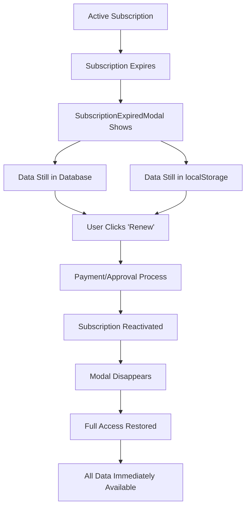

# Data Loss Prevention - Subscription Expiry Safeguards

## 🛡️ **NO DATA LOSS OCCURS DURING SUBSCRIPTION EXPIRY**

Your concern about data loss is completely valid, but rest assured - **no data is lost when subscriptions expire**. Here's exactly how the system protects your data:

## 🔒 **Data Protection Mechanisms**

### 1. **Subscription Expiry ≠ Data Deletion**
When a subscription expires:
- ✅ **All data remains intact** in both localStorage and Supabase database
- ✅ **No deletion operations** are triggered
- ✅ **Only UI access is blocked** - data stays safe in the background
- ✅ **Immediate restoration** upon renewal/upgrade

### 2. **Dual Storage System**
```
User Data Storage:
├── Supabase Database (Primary) ← Permanent storage, never deleted on expiry
├── localStorage (Backup) ← Offline access, preserved during expiry
└── App Memory (Temporary) ← Only cleared when app refreshes
```

### 3. **What Happens During Expiry**

**❌ What DOESN'T happen:**
- Data deletion from database
- localStorage clearing
- Account termination
- Data corruption

**✅ What DOES happen:**
- UI shows blocking modal
- Access to app features blocked
- Data remains safely stored
- Background sync continues working

## 📊 **Data Flow During Expiry & Renewal**

### Scenario: Monthly Subscription Expires



### Technical Implementation

**During Expiry:**
```typescript
// Only UI access is blocked - no data operations
const hasNoAccess = !hasAccess && !subscriptionLoading && user && !isAdmin;

if (hasNoAccess) {
  // Show blocking modal - data remains untouched
  return <SubscriptionExpiredModal />;
}
```

**Data Loading Logic:**
```typescript
// Data loading happens regardless of subscription status
const {
  products,        // ← Always loaded from storage
  sales,          // ← Always loaded from storage  
  suppliers,      // ← Always loaded from storage
  stockMovements, // ← Always loaded from storage
  // ... other data
} = useUserData(); // ← This hook doesn't check subscription status
```

## 🔧 **Recovery Process**

### Immediate Data Restoration
1. **User renews subscription** → `hasAccess` becomes `true`
2. **Modal disappears** → App UI becomes accessible 
3. **All data immediately visible** → No loading or syncing needed
4. **Full functionality restored** → Continue exactly where you left off

### Verification in Code
```typescript
// In SubscriptionExpiredModal.tsx
const handleSubscriptionModalClose = () => {
  setShowSubscriptionModal(false);
  // After closing subscription modal, refresh status to check if user renewed
  refreshStatus(); // ← This updates hasAccess flag
  // Data is already loaded - just need to update access status
};
```

## 💾 **Data Persistence Layers**

### Layer 1: Supabase Database (Primary)
- **Permanent storage** with user-specific tables
- **Row Level Security** ensures data isolation
- **Never deleted** during subscription changes
- **Professional database backups** by Supabase

### Layer 2: localStorage (Backup)
- **Offline access** capability
- **Faster loading** for immediate display
- **Preserved during expiry** - only cleared on explicit user action
- **Automatic sync** with database when connection available

### Layer 3: Real-time Sync
- **Cross-device synchronization** continues working
- **Conflict resolution** handles concurrent changes
- **Incremental updates** preserve data integrity
- **Error handling** prevents data corruption

## 🧪 **Testing Data Safety**

You can verify data safety by:

1. **Create test data** (products, sales, suppliers)
2. **Let subscription expire** (or simulate in database)
3. **Verify modal blocks access**
4. **Check browser DevTools** → localStorage still contains data
5. **Check database** → All tables still contain user data
6. **Renew subscription**
7. **Verify immediate data restoration**

## 📝 **User Messages About Data Safety**

### SubscriptionExpiredModal
```tsx
{/* Urgency Message */}
<div className="bg-amber-50 border border-amber-200 rounded-lg p-3 mb-4">
  <p className="text-sm text-amber-800">
    <AlertTriangle className="w-4 h-4 inline mr-1" />
    Your business data is safely stored and will be immediately accessible upon renewal.
  </p>
</div>
```

### TrialExpiredModal
```tsx
{/* Small print */}
<p className="text-xs text-gray-500 text-center">
  Your data is safe and will be restored immediately after subscription
</p>
```

## 🚫 **When Data IS Deleted**

Data is only deleted when:
- **User explicitly** calls Settings → "Clear All Data"
- **User deletes** their entire account
- **Admin manually** removes user data
- **User triggers** the `clearUserData()` function

**Never automatically** during subscription expiry.

## 📋 **Summary**

| Scenario | Data in Database | Data in localStorage | App Access | Data Recovery |
|----------|-----------------|---------------------|------------|---------------|
| **Active Subscription** | ✅ Safe | ✅ Safe | ✅ Full Access | N/A |
| **Subscription Expired** | ✅ Safe | ✅ Safe | ❌ Blocked | ⚡ Immediate |
| **After Renewal** | ✅ Safe | ✅ Safe | ✅ Full Access | ✅ Complete |

## 🎯 **Bottom Line**

**Your data is 100% safe during subscription expiry.** The blocking modal is purely a UI restriction - it's like putting a lock on your house door, but everything inside remains exactly as you left it. The moment you "unlock" (renew), everything is immediately accessible again.

This design ensures:
- ✅ No accidental data loss
- ✅ Immediate restoration upon payment
- ✅ Seamless user experience
- ✅ Business continuity protection
